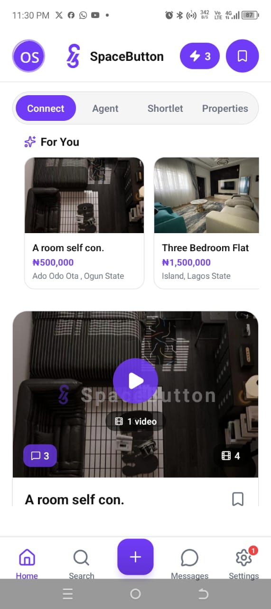
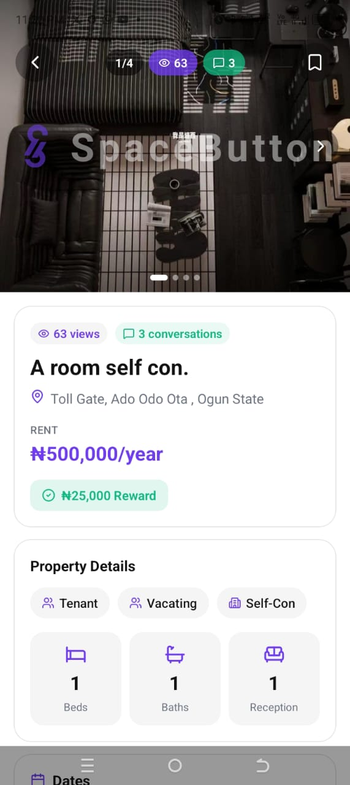
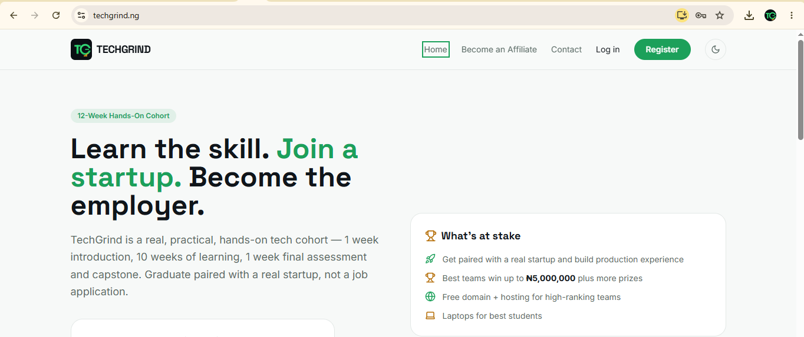
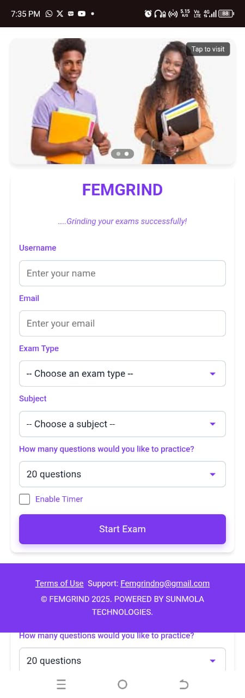

# Oluwafemi Sunmola

**Product Manager | Lagos, Nigeria**

I turn messy problems into shipped products. I've owned products end to end across proptech, edtech and energy commerce, working in Agile/Scrum and Waterfall, from requirements and roadmap through to launch and growth.

[LinkedIn](https://linkedin.com/in/oluwafemisunmola) · [Email](mailto:oluwafemisunmola2020@gmail.com)

**What I do:** Product strategy · Roadmapping · PRDs and user stories · User research · Product analytics · Go-to-market · Working with developers

---

## Selected work

### 1. Spacebutton: peer-to-peer rental marketplace

  

**Problem:** Renting in Nigeria means paying agents heavy fees, and people who must move out unexpectedly lose rent they have already paid.

**Users:** Renters aged 19 to 45, vacating tenants, agents and landlords.

**What it does:** Nigeria's first peer-to-peer rental platform. People leaving an apartment connect directly with people looking for one, without expensive agents. Vacating tenants earn a reward when their space is taken, and users buy "connects" to reach listings, with referral rewards.

**My role:** Product Manager, February to October 2026. I owned the product end to end:
- Wrote the PRD, 90-day MVP targets and the launch plan, including a risk register.
- Managed the roadmap and backlog, and coordinated the iOS, Android and web launch.
- Flagged the App Store and Play Store approval delay as a risk before launch, and planned the go-to-market around it.
- Set up product analytics and reporting for the directors.
- Supported field outreach and an agent community to grow supply.

**Result:** Launched on the App Store and Play Store in August 2026. 546 app downloads and 56 listings across Lagos LGAs by the time I left.

**Stack:** [python] · [spacebutton.net](https://spacebutton.net)

---

### 2. TechGrind: 12-week tech cohort with startup placement

**Problem:** Graduates learn skills but lack real project experience, and employers want proof, not certificates.

**Users:** Undergraduates, fresh graduates, NYSC members and career switchers.

**What it does:** A hands-on cohort: 1 week of introduction, 10 weeks of learning, and 1 week of final assessment and capstone. Graduates are paired with a real startup. The best teams can win funding and prizes, and an affiliate program rewards referrers.

**My role:** I built the product and run its go-to-market:
- Defined the curriculum model, pricing and student journey.
- Shipped live payments, weekly assessments with grading and an affiliate dashboard.
- Run affiliate recruitment, remote marketers and social campaigns.

**Result:** 20 students pledged ahead of the first cohort starting 1 December 2026.

**Stack:** React · Flutterwave · [NodeJS] · [techgrind.ng](https://www.techgrind.ng)

---

### 3. Femgrind: AI-powered CBT practice for WAEC, NECO and JAMB

**Problem:** Secondary school students in Nigeria need realistic computer-based exam practice for WAEC, NECO and JAMB, and many have none.

**Users:** Students preparing for WAEC, NECO and JAMB, and the schools that support them.

**What it does:** A mobile-friendly web app where students pick an exam, a subject, the number of questions and an optional timer, then practise under real exam conditions.

**My role:** Chief Product Coordinator and People Operations Officer, 2024 to 2025:
- Delivered the product end to end using Agile.
- Started a school-to-school partnership programme.
- Ran people operations from recruitment to exit.

**Result:** [add one number: students reached, practice sessions run or schools reached]

**Stack:** [add you] · [femgrind.com.ng](https://femgrind.com.ng)

---

## Contact

Open to product manager and product coordinator roles.
Email: oluwafemisunmola2020@gmail.com · [LinkedIn](https://linkedin.com/in/oluwafemisunmola)
